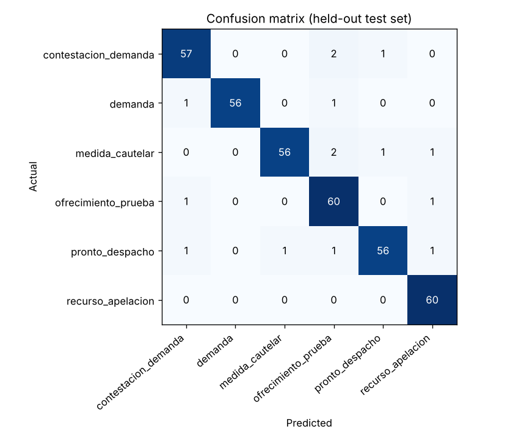

# Legal Filing Classifier

NLP service that reads an Argentine court filing (*escrito judicial*), says what kind of filing it is and extracts its key facts: case number, parties, matter, court, dates and amounts. Built with **scikit-learn** and served with **FastAPI**.

It follows up on my research work applying NLP to legal documents at LIFIA (UNLP), packaged as a small, testable service.

> **About the data.** Real filings contain personal data and can't be redistributed, so this repo ships with a **synthetic corpus** produced by `data/generate.py`. The generator mixes shared legal boilerplate, type-specific wording, sentences borrowed from other types, dropped sentences and 3% random label noise, so the task isn't trivially separable. To use real data, replace `data/escritos.csv` with an anonymized file that has the same two columns (`text`, `label`); nothing else changes.

## What it classifies

| Label | Filing type |
| --- | --- |
| `demanda` | Demanda (complaint) |
| `contestacion_demanda` | Contestación de demanda (answer) |
| `recurso_apelacion` | Recurso de apelación (appeal) |
| `medida_cautelar` | Solicitud de medida cautelar (injunction / attachment request) |
| `ofrecimiento_prueba` | Ofrecimiento de prueba (evidence offering) |
| `pronto_despacho` | Pedido de pronto despacho (request to speed up a pending decision) |

## Results

On 1,800 synthetic filings (300 per class), 80/20 stratified split:

| Model | 5-fold CV macro F1 |
| --- | --- |
| Complement Naive Bayes | **0.955** (selected) |
| Linear SVM (calibrated) | 0.953 |
| Logistic regression | 0.946 |

Held-out test macro F1: **0.959**. With 3% of labels randomized on purpose, the ceiling is about 0.97.



The most characteristic terms the model learned match the legal vocabulary of each filing type, e.g. *medida cautelar, decrete, no innovar* for injunctions or *pronto despacho, resuelva* for requests to speed up a decision.

## How it works

1. **Normalization** (`classifier/preprocess.py`): lowercase, strip accents (keeping ñ), and remove the case number, the caption with the parties' names, numbers and legal boilerplate words. Removing the caption matters: it identifies the *case*, not the *type of filing*, and keeping it would let the model memorize parties.
2. **Features**: TF-IDF on word 1-2 grams (legal formulas like "recurso de apelación") plus character 3-5 grams (robust to typos and inflections), combined with a `FeatureUnion`.
3. **Model selection**: three linear models compared with stratified 5-fold cross-validation on the training split only; the best one is evaluated once on the held-out test set and then refit on all data.
4. **Explanations**: for each prediction the API returns the terms in the document that pushed it toward the chosen class.
5. **Key-fact extraction** (`classifier/extract.py`): regular expressions for the case number, caption (plaintiff, defendant, matter), court, dates and amounts in Argentine number format.

## Run it

```bash
pip install -r requirements-dev.txt
python -m data.generate          # writes data/escritos.csv
python -m classifier.train       # writes artifacts/ and reports/confusion_matrix.png
uvicorn api.main:app --reload    # http://localhost:8000/docs
```

With Docker (the image trains the model at build time):

```bash
docker build -t legal-classifier .
docker run -p 8000:8000 legal-classifier
```

## API

```bash
curl -X POST localhost:8000/classify -H 'content-type: application/json' -d '{
  "text": "Expte. N° 4521/2025 \"Benítez, Carla c/ Seguros La Unión S.A. s/ cumplimiento de contrato\"\nJuzgado Civil y Comercial N° 3 de La Plata\nVengo a apelar la sentencia dictada el 2/10/2025 por no valorar la pericia contable. Solicito se conceda el recurso y se eleven las actuaciones a la Alzada."
}'
```

```json
{
  "prediction": {"label": "recurso_apelacion", "name": "Recurso de apelación", "confidence": 0.996},
  "alternatives": [{"label": "contestacion_demanda", "...": "..."}, {"label": "ofrecimiento_prueba", "...": "..."}],
  "evidence": ["dictada", "eleven", "recurso", "conceda", "solicito conceda"],
  "key_facts": {
    "case_number": "4521/2025",
    "plaintiff": "Benítez, Carla",
    "defendant": "Seguros La Unión S.A.",
    "matter": "cumplimiento de contrato",
    "court": "Juzgado Civil y Comercial N° 3 de La Plata",
    "dates": ["2/10/2025"],
    "amounts": []
  },
  "low_confidence": false
}
```

| Method | Path | Description |
| --- | --- | --- |
| POST | `/classify` | Classify a filing and extract key facts |
| GET | `/labels` | Labels and their names |
| GET | `/model` | Selected model and its metrics |
| GET | `/health` | Checks that the model is loaded |

## Tests

```bash
pytest
```

They cover normalization, key-fact extraction, reproducibility of the generator, training quality (well above chance), explanations for two model types, and the API.

## Limitations and next steps

- Trained on synthetic data: accuracy on real filings will be lower until it's retrained on an anonymized real corpus.
- Naive Bayes probabilities are overconfident; for a reliable `confidence` value, calibrate them (`CalibratedClassifierCV`) on real data.
- Next: a fine-tuned Spanish transformer (e.g. a BETO or RoBERTa-legal model) to compare against this baseline, and named-entity recognition instead of regular expressions for the parties.

## License

MIT
